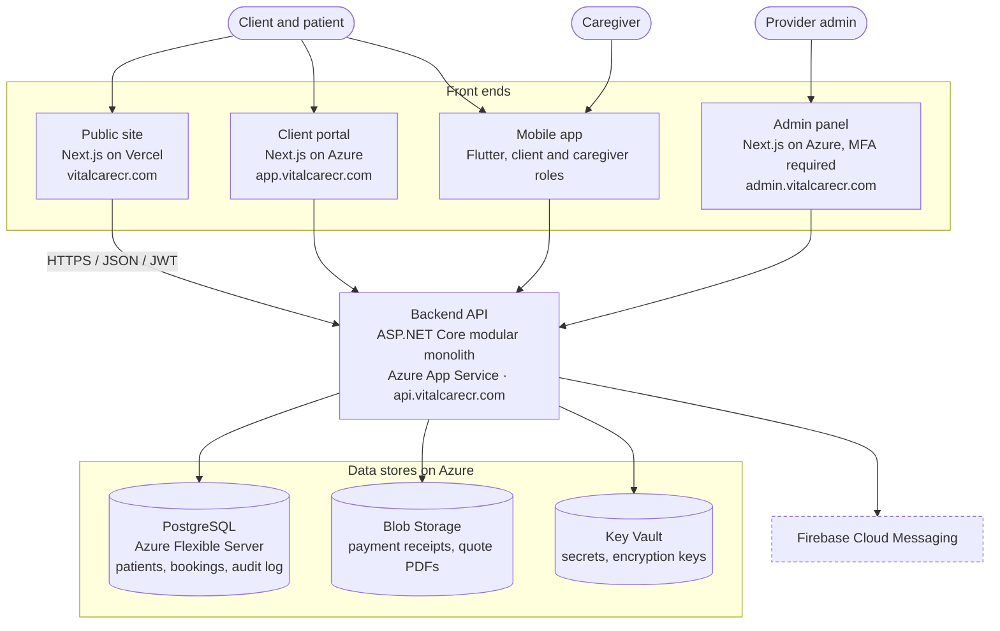

# C4 container view

The Backend API is the single gateway to data: the four front ends never touch PostgreSQL, Blob Storage or Key Vault directly.

Related decisions: [ADR-001](../adr/0001-backend-aspnet-core-modular-monolith.md), [ADR-002](../adr/0002-postgresql-primary-database.md), [ADR-003](../adr/0003-single-flutter-app-with-roles.md), [ADR-008](../adr/0008-react-nextjs-portal-and-admin.md), [ADR-007](../adr/0007-azure-cloud-provider.md).
